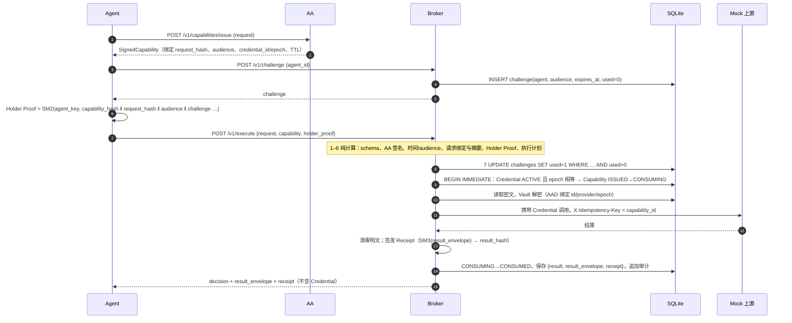
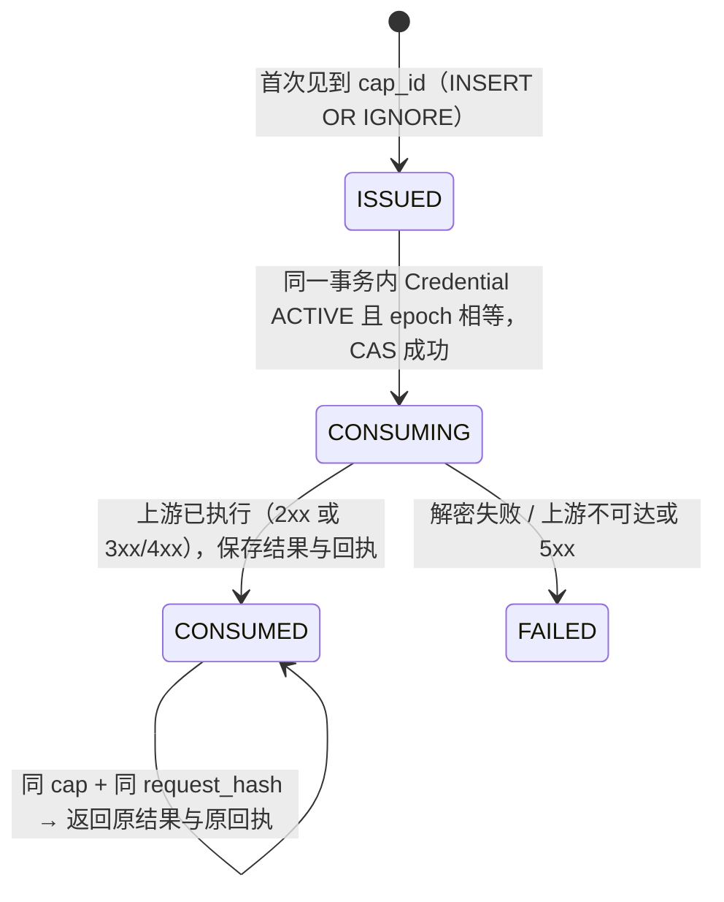

# Credential Broker 设计说明

> 适用版本：阶段二至四完成后的 `credential-broker/`。
> 协议字段、签名输入与编码以 A 的 `shared/` 和 `docs/crypto-protocol.md` 为准，本文只说明 Broker 如何实现、为什么这样实现。
> 接口与配置见 [README](../README.md)，审计链字节格式见 [docs/audit-chain.md](../../docs/audit-chain.md)，威胁与防御对照见 [security-mapping.md](security-mapping.md)。

## 1. Broker 在系统中的位置

AA 回答“这件事该不该做”，Broker 回答“这张使用权现在能不能兑现”。两者职责刻意分开：

| 问题 | 由谁判断 | 依据 |
|---|---|---|
| 这个任务允许访问哪个服务、资源、操作 | AA | 服务端可信任务库（Agent 写不进去） |
| 拿着 Capability 的是不是被授权的 Agent | Broker | Holder Proof 签名 + Broker 自己下发的 Challenge |
| 实际请求和被授权的请求是不是同一个 | Broker | 自己重算 SM3 请求摘要 |
| Credential 现在还能不能用 | Broker | 本地 Credential 状态与 Epoch（同一事务内） |
| 这张 Capability 是否已经用过 | Broker | 本地消费状态机 |
| 实际执行了什么 | Broker | Broker 签名的 Execution Receipt + 审计链 |

后四个问题只有 Broker 掌握实时状态，因此只能由 Broker 判断。Agent 和 AA 都拿不到长期 Credential，Credential 只存在于 Broker 的 Vault 中。

```text
不可信                      可信（签名者）              可信（执行点）                 受保护服务
┌──────────────┐  request  ┌──────────────┐           ┌──────────────────────────┐    ┌──────────┐
│ 用户 / 外部内容 │ ───────▶ │      AA      │           │         Broker           │    │ Mock Git │
│ LLM / Agent  │ ◀─────── │ 可信任务库     │           │ 校验流水线 → 原子消费       │───▶│ Mock DB  │
│ Holder 私钥   │ Capability│ SM2 签发      │           │ Vault（SM4-GCM）           │    └──────────┘
└──────┬───────┘           └──────────────┘           │ 回执签发 / 审计链 / Challenge│
       │ request + capability + holder_proof           └──────────────────────────┘
       └──────────────────────────────────────────────▶ 唯一能拿到 Credential 的进程
```

## 2. 模块划分

依赖方向自上而下，下层不引用上层：

```text
cmd/broker                 装配：配置 → 密钥 → DB → 各服务 → HTTP
internal/api               HTTP 外壳：严格解码、管理员鉴权、错误码 → HTTP 状态
internal/execution         可信执行路径的编排（唯一会解密 Credential 并调用上游的地方）
internal/verifier          有序校验流水线 + 请求到上游调用的精确映射
internal/receipt           result_envelope 与 Execution Receipt
internal/protocol          A 协议对象的严格 Go 实现、请求摘要、SM2 域分离签名、可信公钥表
internal/canonical         ZTCANON-JSON-v1 严格解析与编码
internal/capability        原子消费状态机、幂等、重放防护
internal/credential        Credential 生命周期与 Epoch
internal/challenge         Broker Challenge
internal/evidence          SM3 哈希链 + SM2 签名检查点
internal/vault, secret     SM4-GCM 加密存储；不可打印的 Secret 类型
internal/crypto            gmsm 的薄封装（SM2 / SM3 / SM4-GCM），不自研原语
internal/repository        SQLite（WAL，所有事务 BEGIN IMMEDIATE）
internal/upstream          上游客户端与 Mock 服务
```

几个刻意的边界：

- **`verifier` 只做判断，不碰 Credential。** 前六个步骤是纯计算，第七步只写 Challenge 表。流水线产出的 `Plan` 是唯一能进入执行阶段的东西，而且只能由校验步骤填写。
- **`execution` 是唯一调用 `Credentials.Open` 和 `Upstream.Do` 的地方。** 拒绝路径从结构上就到不了这两行（见 `TestDeniedRequestNeverTouchesCredential`）。
- **`api` 不做安全判断。** 它只负责解码、鉴权管理接口，以及把拒绝码映射成 HTTP 状态码。

## 3. 一次执行的完整时序



## 4. 校验流水线

实现见 `internal/verifier/steps.go`，顺序遵循 `docs/a-b-interface.md`：

| # | 步骤 | 检查内容 | 典型拒绝码 |
|---|---|---|---|
| 1 | `schema` | 严格 `ZTCANON-JSON-v1` 解析（拒绝浮点、超出 int64 的整数、重复键、非法转义与孤立代理项、BOM、尾随数据、过深嵌套）；按 A 的 schema 解码，拒绝未知字段与类型错误 | `CANONICALIZATION_ERROR`、`SCHEMA_VALIDATION_FAILED` |
| 2 | `capability_signature` | issuer 必须等于配置的可信 AA；签名的 key_id 必须等于 body 中的 issuer_key_id；公钥按“存在 → 状态 → 用途 → 主体 → 有效期”查找；SM2 域分离验签 | `UNTRUSTED_ISSUER`、`UNKNOWN_KEY`、`INVALID_SIGNATURE` |
| 3 | `capability_validity` | `issued_at` 不在未来（允许 5 秒时钟偏差）、未过期、`audience` = 本 Broker | `CAPABILITY_EXPIRED`、`AUDIENCE_MISMATCH` |
| 4 | `request_binding` | Agent / 任务 / 服务 / 资源 / 操作 / Credential ID 与 Capability 逐项一致；Broker **自己**重算 SM3 请求摘要，必须等于签名中的 `request_hash` | `REQUEST_BINDING_MISMATCH`、`REQUEST_HASH_MISMATCH` |
| 5 | `holder_proof` | key_id 一致、audience、时间窗；`capability_hash` 覆盖整张签名 Capability；`request_hash` 同时等于重算值和 Capability 中的值；Agent 公钥查找后 SM2 验签 | `HOLDER_BINDING_MISMATCH`、`PROOF_EXPIRED`、`INVALID_SIGNATURE` |
| 6 | `execution_plan` | 把 AgentRequest **精确**映射为上游调用：method、path、resource、body 必须共同指向同一个对象，多余的 query 或字段一律拒绝 | `UNSUPPORTED_OPERATION` |
| 7 | `challenge` | 原子消费：必须由本 Broker 签发给这个 Agent、audience 正确、未过期、未使用 | `CHALLENGE_UNKNOWN`、`CHALLENGE_USED`、`CHALLENGE_WRONG_AGENT` |

**为什么是这个顺序：**

1. **先验签，再相信任何字段。** 第 2 步之前，Capability 里的每个字段都可能是伪造的，所以第 3–6 步只用验签之后的字段。DENIED 回执也只为通过第 2 步的请求签发，Broker 不为伪造的 capability_id 背书。
2. **第 4 步在第 5 步之前。** Holder Proof 要绑定的是 Broker 重算出的请求摘要，而不是 Agent 自称的摘要。
3. **第 6 步在第 7 步之前。** 前六步都不写状态，任何能静态判定的拒绝都在消费 Challenge 之前发生，坏请求不会白白烧掉一个 Challenge（`TestRejectedRequestDoesNotBurnChallenge`）。
4. **Credential 检查不在流水线里。** 它必须和 Capability 的状态转换处于同一写事务，否则会出现“检查时有效、使用时已撤销”的竞态，所以放进了 `capability.Store.Consume`（见第 5 节）。

每一步都会记录是否通过和耗时（`decision.steps`，同时写入 `/v1/metrics` 的 `verify.<step>`），Dashboard 可以直接画出请求在哪一步被拦下。

**fail closed 的具体体现：**

- 存储故障时 Challenge 步骤返回 `INTERNAL_ERROR` 拒绝，而不是放行。
- 流水线通过、却没有产出执行计划时，执行器也拒绝。
- 未配置可信 issuer 或公钥表时，`/v1/execute` 整体返回 `EXECUTION_DISABLED`。

## 5. Atomic Consume：保证至多一次副作用

### 5.1 状态机



实现见 `internal/capability/consume.go`。整个 `Consume` 在一个 `BEGIN IMMEDIATE` 事务中完成：

1. `INSERT OR IGNORE` 登记 cap_id 及其 request_hash、credential_id、credential_epoch、nonce。nonce 有唯一索引（`docs/a-b-interface.md` 第 7 步要求检查 Capability nonce）。
2. 读回记录：读不到说明 nonce 已属于另一张 Capability，返回 `CAPABILITY_NONCE_REUSED`；claim（含 nonce）不一致返回 `CAPABILITY_CLAIM_MISMATCH`；request_hash 不一致返回 `IDEMPOTENCY_CONFLICT`。
3. 按当前状态分支：已 `CONSUMED` 则返回保存的结果（幂等重放）；`CONSUMING` 返回 `REPLAY_IN_PROGRESS`；`FAILED` 返回 `CAPABILITY_ALREADY_FAILED`。
4. **线性化点**：`credential.CheckUsable`（Credential 为 ACTIVE 且 epoch 相等）与 `UPDATE … SET state='CONSUMING' WHERE state='ISSUED'` 在同一事务内执行，以受影响行数判定胜负，同时写入审计条目 `capability.consume`。

任何一步出错，事务都会整体回滚，数据库里不留状态（`TestDeniedConsumeLeavesNoState`）。

### 5.2 为什么能抗并发重放和撤销竞态

SQLite 的 `BEGIN IMMEDIATE` 在事务开始时就拿到写锁，所以 Consume、Rotate、Revoke 等所有状态变更**严格串行**：

- **并发重放**：同一 cap_id 的 N 个请求同时到达，只有一个能看到 `ISSUED` 并完成 CAS。其余的要么看到 `CONSUMING`（返回 409 `REPLAY_IN_PROGRESS`），要么看到 `CONSUMED`（拿到原结果）。测试覆盖两层：消费层 100 个 goroutine 并发，恰好 1 个胜出（`TestConcurrentReplayExactlyOneWinner`、`TestConcurrentReplayOneSideEffect`）；完整协议层 20 个各带独立 Challenge 的合法 bundle 并发提交写操作，上游写入恰好 1 次（`TestConcurrentReplayWriteSideEffectOnce`）。均在 `-race` 下运行。
- **撤销竞态**：Revoke 会让 epoch 加一，并且和 Consume 抢同一把写锁。每次竞争中，要么 Consume 在前（审计序号更小，这次执行合法），要么 Revoke 在前（Consume 看到 `REVOKED`，被拒绝）。不会出现“撤销之后仍以旧 epoch 消费成功”（`TestRevocationRaceIsLinearizable`，40 轮，用审计序号核对先后）。
- **消费之后、解密之前被撤销**：`Credentials.Open` 会再检查一次状态和 epoch，而且 Vault 的 AAD 绑定 epoch，旧密文在新 epoch 下也解不开。这种情况返回 `CREDENTIAL_UNAVAILABLE`，Capability 进入 `FAILED`。

### 5.3 为什么不是严格的 exactly-once

Broker 保证的是：

> 每张 Capability **至多**产生一次上游副作用；一旦执行成功，之后用同一请求重放都返回同一结果和同一张回执。

做不到严格 exactly-once，原因是外部 API 和 Broker 的本地数据库不在同一个事务里。两者之间总有一段时间窗，崩溃会落在三种情况之一：

| 崩溃时机 | 上游是否执行 | Broker 状态 | 后果 |
|---|---|---|---|
| CAS 之后、调用上游之前 | 否 | `CONSUMING` | 这张 Capability 作废，需要重新签发，**不会重复执行** |
| 上游返回之后、写回 `CONSUMED` 之前 | 是 | `CONSUMING` | 副作用发生了一次，但 Broker 没有记录结果 |
| 上游超时（不知道对方是否执行） | 未知 | `FAILED` | Broker 不会重试，最坏情况是执行了一次 |

三种情况都满足“至多一次”，代价是可能“零次”：在安全和可用之间，Broker 选择了安全。要把“至多一次”补成“恰好一次”，需要外部服务配合实现幂等。Broker 已经在每次调用里带上 `X-Idempotency-Key: <capability_id>` 和 `X-Request-Hash`，Mock 服务据此去重（`TestWriteSideEffectsAndIdempotency`）。将来如果加恢复流程，可以安全地重试卡在 `CONSUMING` 的调用，由上游负责去重。

上游已经处理、但返回 3xx/4xx 时，Capability 记为 `CONSUMED`（回执 `outcome=ERROR`，`code=UPSTREAM_REJECTED`），不允许重试。原因是上游可能已经产生了部分副作用，只有 Broker 自己能确认没有副作用的失败（解密失败、上游不可达、5xx），才会记为 `FAILED`。

## 6. Credential Vault 与生命周期

### 6.1 加密

- 算法：SM4-GCM（`internal/crypto/sm4gcm.go`），每次加密使用新的随机 nonce。
- 主密钥 `K_V`：16 字节，只从 `BROKER_VAULT_KEY` 环境变量读取，不写入数据库，不写入日志。
- AAD：`"ACG-VAULT-v1" ‖ u32be(len(id)) ‖ id ‖ u32be(len(provider)) ‖ provider ‖ u64be(epoch)`。
  - 字段带长度前缀，保证 `"a"+"bc"` 和 `"ab"+"c"` 得到不同的字节（`TestAADIsUnambiguous`）。
  - 把密文挪到另一个 Credential 或另一个 epoch 下，GCM 认证都会失败（`TestVaultBindsMetadata`）。
- 数据库文件权限 0600。库里只有密文，数据库文件泄露时如果没有 `K_V` 也解不开。

### 6.2 Epoch

Credential 的任何状态变更（Rotate、Disable、Enable、Revoke、Compromise、Destroy）都会让 **epoch 加一**，并在新 epoch 的 AAD 下重新加密：

- 签发时绑定旧 epoch 的 Capability 立即失效。
- Disable 再 Enable 之后，旧 Capability 也不会复活（`TestDisableEnableDoesNotReviveOldEpoch`）。
- Destroy 会清空密文；之后用同一个 ID 重新创建，epoch 在原值基础上继续递增，旧票据永远不会再匹配。

状态迁移表见 `internal/credential/lifecycle.go` 的 `transitions`。`GET /v1/credentials/{id}/status` 只返回状态和 epoch，供 AA 签发时读取。

### 6.3 Credential 明文在哪里出现

| 位置 | 时机 | 处理 |
|---|---|---|
| 管理接口 `POST /v1/credentials`、`…/rotate` | 管理员录入或轮换 | 请求体解码为 `secret.Secret`，立即用 Vault 加密 |
| `credential.reseal` | 生命周期变更时迁移到新 epoch | 解密后立即重新加密，`defer Wipe()` |
| `execution.Executor` | 原子消费成功之后 | `Open` → 只放进上游请求的 `Authorization` 头 → 调用返回后 `cred.Wipe()` |

`secret.Secret` 的 `String`、`GoString`、`LogValue`、`MarshalJSON` 都输出 `[REDACTED]`，通过 `fmt`、`slog` 或 JSON 响应都打印不出明文（`TestSecretNeverPrinted`、`TestRedaction`）。访问日志只记录方法、路径、状态码和耗时，不记录请求体和请求头。

**已知局限：** 拼接 `Authorization` 头时会产生一份 Go 字符串副本，`net/http` 内部也有缓冲，这些无法主动清零，只能等 GC 回收。`Wipe` 只能缩短明文在内存中的停留时间，不能保证内存里不留痕迹。要防御能读 Broker 进程内存的攻击者，需要 HSM 或机密计算，这已超出本项目的信任假设。

## 7. Broker Challenge

- 32 字节 CSPRNG，小写十六进制（满足 A 的 `^[0-9a-f]{32,64}$`）。
- 记录绑定的 agent_id、audience（本 Broker）、过期时间（默认 60 秒）和是否已用。
- 消费是一条带全部条件的 `UPDATE … WHERE used=0 AND expires_at > now`，靠受影响行数判定。失败后再查一次，给出具体原因（未知、已用、过期、Agent 不对、audience 不对）。
- 后台按 TTL 周期清理过期记录。

Challenge 用来防止“同一份 Holder Proof 再提交一次”。Capability 的消费状态用来防止“同一张 Capability 换一个新 Challenge 再执行一次”。两层各管一件事：对后一种情况，Broker 返回已保存的结果，不再调用上游（`TestReplaySameCapabilityNewChallenge`）。

## 8. Execution Receipt

- 由 Broker 的 SM2 密钥签名，签名域为 `EXECUTION_RECEIPT`，与 Capability、Holder Proof 的签名域互相隔离，签名不能跨用途复用。
- `result_hash = SM3(ZTCANON(result_envelope))`。envelope 绑定了 capability_id、request_hash、outcome、code、上游状态码和上游响应体。结构是 B 的提案，见 [README](../README.md#execution-receipt)，待 A、C 联审。
- 签发前先用 `protocol.DecodeExecutionReceipt` 自检，Broker 不会签出 A 的校验器无法解析的回执（`TestIssueRefusesMalformedReceipt`）。
- 三种 outcome：
  - `SUCCESS`：上游返回 2xx。
  - `ERROR`：上游返回 3xx/4xx、上游失败，或解密失败。
  - `DENIED`：只为通过第 2 步验签的请求签发。
- Broker 公钥以 A 的 `KeyRegistryDocument` 格式发布在 `GET /v1/broker/key-registry`，用途为 `RECEIPT_SIGNING`。A 的 `ReceiptVerifier` 可以直接验证（`make interop`、`e2e-demo.py`）。

**为什么回执必须由 Broker 签：** 只有 Broker 确切知道是否调用了上游、上游返回了什么。AA 签发时请求还没执行，Agent 是不可信方，上游服务不了解 Capability 协议。

## 9. 审计链

- 每个状态变更都在**同一事务**内追加审计条目，与业务状态原子提交，不会出现“状态变了但没留痕”：Credential 生命周期、`capability.consume`、`capability.complete`、`capability.fail`。拒绝事件（`execute.deny`）单独开事务记录。
- `H_i = SM3(H_{i-1} ‖ L_i)`。每隔 `BROKER_CHECKPOINT_EVERY` 条（默认 100）用**专用的检查点私钥**对 `(seq, head_hash, created_at)` 签一个检查点。A 的公钥模型里 `RECEIPT_SIGNING` 只签回执，所以检查点不复用回执密钥，公钥单独发布在 `/v1/broker/public-key` 的 `checkpoint_key`。
- 修改、删除、重排条目，或回滚到检查点之前，都能被 `VerifyChain` 和 `GET /v1/audit/verify` 检测出来（`TestChainTamperDetection`）。
- 审计内容不包含 Credential 明文或密文。

字节格式见 [docs/audit-chain.md](../../docs/audit-chain.md)。

## 10. 密钥与信任配置

| 材料 | 来源 | 谁能看到 |
|---|---|---|
| Vault 主密钥 `K_V` | `BROKER_VAULT_KEY`（由 `gen-env.sh` 生成到已 gitignore 的 `.env`） | 仅 Broker 进程 |
| Receipt 签名私钥 | `BROKER_SIGNING_KEY_FILE`，不存在时生成，权限 0600；公钥以 `RECEIPT_SIGNING` 发布 | 仅 Broker 进程 |
| 审计检查点私钥 | `BROKER_CHECKPOINT_KEY_FILE`，必须与上一项不同（启动时检查） | 仅 Broker 进程 |
| 管理员令牌 | `BROKER_ADMIN_TOKEN`（至少 16 字符，常量时间比较） | 运维 / 实验脚本，**Agent 不持有** |
| AA 与 Agent 公钥表 | `BROKER_KEY_REGISTRY`，直接读取 A 的 `public-keys.json` | 只读 |
| 可信 AA | `BROKER_TRUSTED_ISSUER` | 配置项，不取自请求 |

`audience`、`trusted_issuer` 和公钥表全部来自 Broker 本地配置，没有一项取自请求。

在 docker compose 里：

- AA 的运行时卷（含私钥）只挂给 AA。
- `trust` 卷只存放 `public-keys.json`，以只读方式挂给 Broker。
- Broker 数据卷归 nonroot 用户（65532）所有。
- 所有端口只绑定 `127.0.0.1`。

## 11. 已知限制

| 限制 | 影响 | 可能的改进 |
|---|---|---|
| 崩溃后 Capability 停在 `CONSUMING` | 这张 Capability 不能再用，需重新签发（fail closed） | 启动时扫描：超时的 `CONSUMING` 改为 `FAILED`；或借助上游幂等键安全重试 |
| 公钥表启动时加载 | 换 AA、Agent 或 Broker 公钥需要重启 | 定期重新加载，或通过 SIGHUP 触发 |
| 审计条目用 `encoding/json` | 字段顺序固定，但不是 `ZTCANON-JSON-v1` | 改用 `internal/canonical`，同步更新 `audit-chain.md` |
| 每次拒绝都签一张 DENIED 回执 | 拒绝路径多一次 SM2 签名 | 视 C 的压测结果改为按需签发 |
| 单机 SQLite | 写入串行，吞吐受限 | 线性化点的语义可以迁移到 PostgreSQL 的 `SELECT … FOR UPDATE` |
| `POST /v1/admin/reset` | 会清空审计链 | 仅开发和实验环境开启（`BROKER_ENABLE_RESET`） |
| Mock 服务可从本机直接访问 | 没有 Credential 只会返回 401，但生产环境需要网络隔离 | 上游只接受来自 Broker 的连接（mTLS 或网络策略） |
